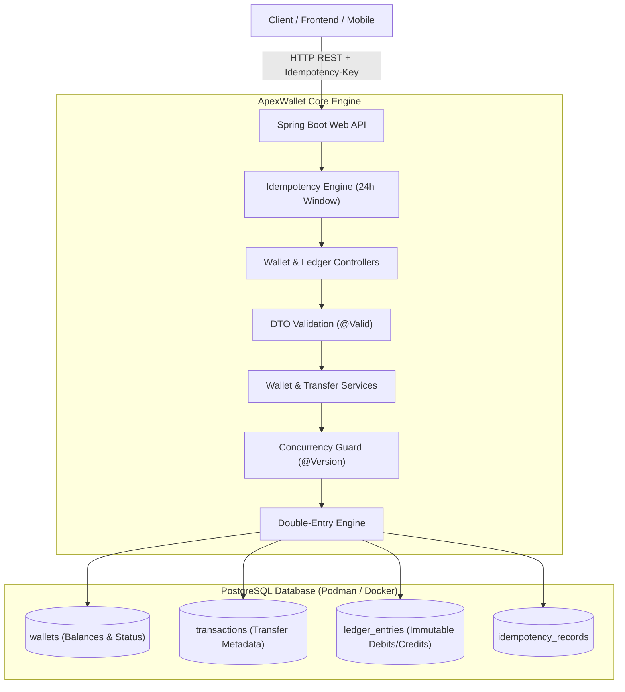
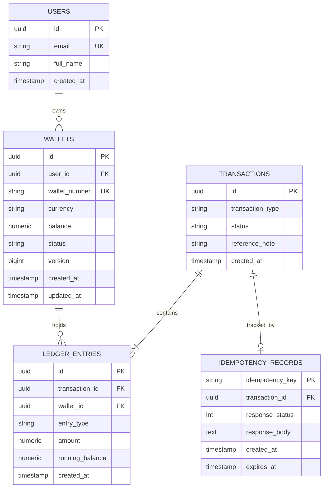
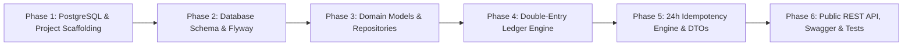

# 🏦 ApexWallet: Enterprise Digital Wallet & Double-Entry Payment Ledger API

## Goal Description
Build **ApexWallet** — a production-grade, audit-compliant digital wallet and double-entry payment ledger REST API in Spring Boot 3+ backed by a real containerized PostgreSQL database.

This project is specifically designed to teach the difference between **toy tutorial code** and **bulletproof production systems**.

---

## 💥 The "Why": What Happens If We Don't Build It This Way?

If you build a wallet the way typical beginner tutorials teach, here are the **5 real-world disasters** that happen in production:

| The Naive Tutorial Way | The Production Disaster | How ApexWallet Solves It | What You Will Learn |
| :--- | :--- | :--- | :--- |
| **1. Just updating a balance column** (`user.balance -= 50`) | **Disaster 1: The Audit Nightmare.** A customer says "$100 is missing from my account." You look at the database and only see the current balance. You have zero proof, zero history, and no way to reconstruct what happened. | **Immutable Double-Entry Ledger:** Every cent is tracked by an append-only ledger entry. The balance is mathematically provable at any second in history. | **Double-Entry Bookkeeping & Audit Trails** |
| **2. Simple `user.save()` on transfer** | **Disaster 2: The Double-Spend Race Condition.** Alice has $100. She clicks "Transfer" twice within 5 milliseconds. Both threads read balance = $100 simultaneously. Both deduct $100. Bob gets $200! Alice only spent $100! Your company loses $100. | **Optimistic Locking (`@Version`) + Database Constraints:** The second concurrent transaction is detected and safely aborted. | **Concurrency Control, Race Conditions, and DB-Level Locking** |
| **3. Using `double` or `float` for money** | **Disaster 3: The Floating-Point Rounding Leak.** Floating-point binary representation does `0.1 + 0.2 = 0.30000000000000004`. Over 100,000 transactions, fractions of cents accumulate or vanish. Regulators shut down your license. | **Exact Fixed-Point Math (`BigDecimal` & SQL `NUMERIC(19,4)`):** Zero precision loss, exact to the fourth decimal place. | **Financial Number Precision in Java & SQL** |
| **4. Retrying HTTP requests without Idempotency** | **Disaster 4: The Double-Charge Glitch.** A user transfers $500 on mobile. The network drops before the response arrives. The mobile app automatically retries. The user is charged $1,000! Angry customer, chargeback fee. | **Idempotency Keys (`Idempotency-Key` header):** The API remembers the key for 24 hours. Retried requests return the exact original result without re-executing the transfer. | **Distributed Idempotency & Network Resilience** |
| **5. Using in-memory H2 or `ddl-auto=update`** | **Disaster 5: Data Loss & Corrupted Schemas.** Server restarts and data vanishes (H2). Or Hibernate automatically modifies a production table column during a deploy, locking tables and wiping data (`ddl-auto`). | **Real Containerized PostgreSQL + Flyway Migrations:** Version-controlled SQL scripts (`V1__...sql`) executed safely on a real relational DB engine. | **PostgreSQL, Flyway Migrations, and Podman/Docker Containerization** |

---

## 🎓 What You Will Learn By Building This

By the end of this project, you will have mastered:
1. **Containerized Relational Engineering:** Running and managing a real PostgreSQL 16 database using Podman/Docker, configuring HikariCP connection pools, and writing production SQL.
2. **Database Version Control (Flyway):** Why enterprise software teams never use Hibernate schema generation, and how to write versioned migrations.
3. **Advanced Concurrency Management:** Preventing double-spending using JPA `@Version` and optimistic locking exceptions.
4. **The DTO Pattern & Clean Architecture:** Complete decoupling of internal database entities from external API contracts.
5. **Enterprise Error Handling (RFC 7807):** Machine-readable error contracts (`ProblemDetail`) instead of arbitrary JSON or stack traces.
6. **Self-Documenting APIs (OpenAPI 3 / Swagger UI):** Auto-generating interactive API documentation at `/swagger-ui.html`.

---

## Architecture & Accounting Foundations



### The Double-Entry Bookkeeping Rule
Money is never created or destroyed out of thin air:
$$\sum (\text{Debits}) + \sum (\text{Credits}) = 0$$

To handle deposits and withdrawals cleanly, we maintain an internal **System Treasury Account** (`SYSTEM_TREASURY_WALLET`):
- **Deposit ($100):** Debit `SYSTEM_TREASURY_WALLET` ($-100.00$), Credit `USER_WALLET` ($+100.00$)
- **Withdrawal ($50):** Debit `USER_WALLET` ($-50.00$), Credit `SYSTEM_TREASURY_WALLET` ($+50.00$)
- **P2P Transfer ($30):** Debit `USER_A_WALLET` ($-30.00$), Credit `USER_B_WALLET` ($+30.00$)

---

## User Review Required

> [!IMPORTANT]
> **Learner Writes 100% of Application Code:**
> Per your instruction, **no application code will be typed by the AI**. The AI will guide specifications, architecture diagrams, step-by-step checklists, SQL schemas, and DTO contracts. You will write all Java code, configuration, and migrations in IntelliJ IDEA.

> [!IMPORTANT]
> **Real Containerized PostgreSQL:**
> We will spin up a real **PostgreSQL 16** container using **Podman** (which is already installed and verified on your system: `podman 6.1.3`).

---

## Database Design & Entity Model



---

## Phased Implementation Roadmap



### Phase 1: PostgreSQL & Project Scaffolding
- [x] Spin up containerized PostgreSQL 16 via Podman:
  ```bash
  podman run -d --name apex-postgres -p 5432:5432 \
    -e POSTGRES_DB=apex_wallet \
    -e POSTGRES_USER=wallet_admin \
    -e POSTGRES_PASSWORD=wallet_secret \
    postgres:16-alpine
  ```
- [x] Initialize project directory using Gradle CLI: `exercises/03-digital-wallet-api`
- [x] Configure `build.gradle` with Spring Boot 3 plugin & enterprise dependencies:
  - `org.springframework.boot:spring-boot-starter-web`
  - `org.springframework.boot:spring-boot-starter-data-jpa`
  - `org.springframework.boot:spring-boot-starter-validation`
  - `org.springframework.boot:spring-boot-starter-actuator`
  - `org.postgresql:postgresql` (runtimeOnly)
  - `org.flywaydb:flyway-core` + `org.flywaydb:flyway-database-postgresql`
  - `org.springdoc:springdoc-openapi-starter-webmvc-ui:2.8.5`
- [x] Configure `application.yml` with connection pool, Flyway, and JPA settings.
- [x] Boot `DigitalWalletApplication` and verify live PostgreSQL connection + Swagger UI initialization!

### Phase 2: Database Schema & Versioned Flyway Migrations
- [x] Create `V1__create_wallet_and_ledger_tables.sql`:
  - `users`, `wallets`, `transactions`, `ledger_entries`, `idempotency_records`
  - Add constraints: `CHECK (balance >= 0.0000)` on user wallets.
- [x] Create `V2__seed_system_treasury.sql`:
  - Seed internal `SYSTEM_TREASURY_WALLET`.

### Phase 3: Domain Entities & Repositories
- [x] `User`, `Wallet` (`@Version`, `WalletStatus`), `Transaction`, `LedgerEntry`, `IdempotencyRecord`
- [x] Repositories with custom queries (`findByWalletNumber`, `findAllByUserId`, `findAllByWalletIdOrderByCreatedAtDesc`).

### Phase 4: Business Logic & Double-Entry Ledger Engine
- [ ] Account status guard (`ACTIVE`, `FROZEN`, `CLOSED`).
- [ ] Atomic money transfer (`@Transactional`):
  - Debit source wallet, credit destination wallet.
  - Insert paired `LedgerEntry` records with calculated `running_balance`.
  - Save master `Transaction` record.

### Phase 5: 24-Hour Idempotency Engine & DTOs
- [ ] Strict DTOs (`CreateWalletRequest`, `DepositRequest`, `WithdrawRequest`, `TransferRequest`, `TransactionResponse`).
- [ ] Idempotency Service:
  - Intercept `Idempotency-Key` header.
  - Return cached result if key was recorded within the last 24 hours.

### Phase 6: Public REST API, Swagger UI & Verification
- [ ] `WalletController` (create, get, freeze, unfreeze).
- [ ] `TransactionController` (transfer, deposit, withdraw, paginated statement).
- [ ] RFC 7807 Global Exception Handling.
- [ ] Verification tests:
  - Test concurrent double-spend protection with `@Version`.
  - Test idempotency replay with repeated network calls.
  - Test frozen wallet rejection.

---

## Verification Plan

### Automated Tests
```bash
# Verify Gradle build & test execution
./gradlew test
```

### Manual Verification
1. **Live PostgreSQL Verification:** Query tables inside the container via `podman exec -it apex-postgres psql -U wallet_admin -d apex_wallet`.
2. **OpenAPI Interactive Documentation:** Inspect and execute requests at `http://localhost:8080/swagger-ui.html`.
3. **Idempotency Proof:** Fire identical requests with the same `Idempotency-Key` and confirm exactly one financial record is created.
4. **Concurrency Race-Condition Proof:** Fire concurrent transfer requests to confirm optimistic locking prevents negative balances.
