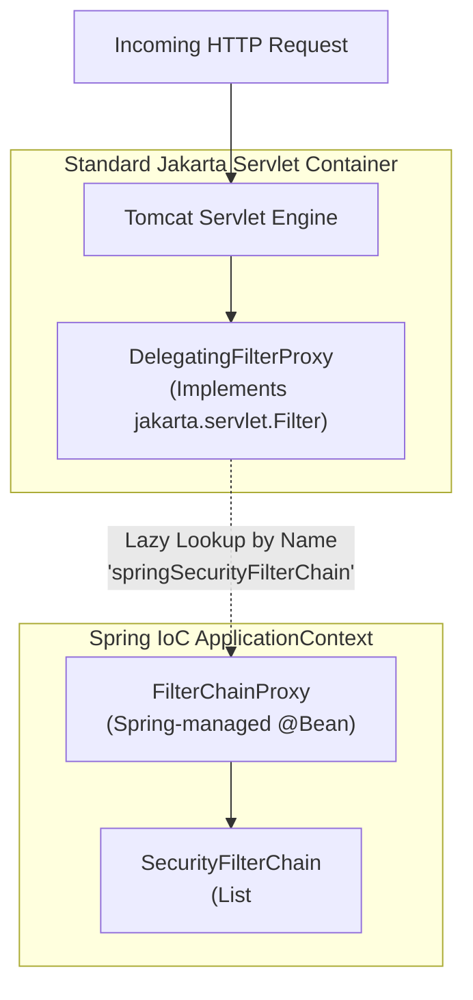
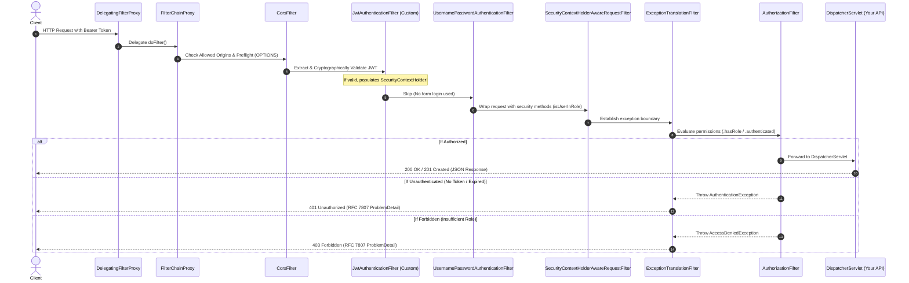
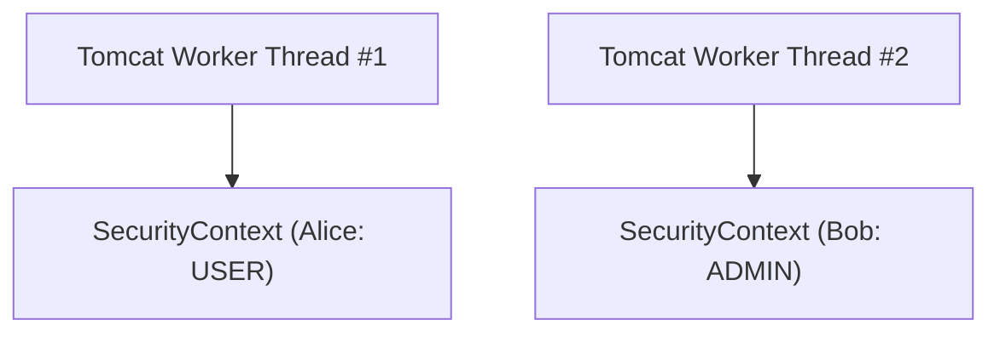

# Deep Dive 06: Spring Security 6 Internals — DelegatingFilterProxy (DFP) & The Security Filter Chain Routine

> **The Feynman Analogy:**  
> - **The Border Checkpoint (Tomcat Servlet Container):** Tomcat is like the physical border gate of a foreign country. It only understands standard international rules (Servlet Filters). It has no idea what Spring is, what a Bean is, or what your PostgreSQL database is.
> - **The Embassy Liaison (`DelegatingFilterProxy`):** Standing at the physical border gate is a single liaison officer. He doesn't inspect passports himself; he forwards every incoming visitor directly to the Embassy's internal security team (`springSecurityFilterChain`).
> - **The Embassy Security Team (`FilterChainProxy` & `SecurityFilterChain`):** A team of specialized security checkpoints (Metal detector, K9 sniffer, Visa verification, Bag check). Each checkpoint does one job. If you clear them all, you are finally escorted to the Ambassador's desk (`DispatcherServlet` & your `@RestController`).

---

## 1. The Core Architectural Problem

Apache Tomcat (or Jetty/Undertow) is an independent Servlet container created by the Java Enterprise (Jakarta EE) standard. 
* Tomcat knows about **Servlet Filters** via `jakarta.servlet.Filter`.
* Tomcat knows **nothing** about the Spring `ApplicationContext`, `@Service`, `@Autowired`, or `@Component`.

If a filter cannot access Spring Beans, how could it possibly query a `UserRepository` or use a `PasswordEncoder` to authenticate someone?

---

## 2. The Bridge: `DelegatingFilterProxy` (DFP)

To connect the Servlet container to the Spring container, Spring provides `DelegatingFilterProxy`.



### How DFP Works Under the Hood:
1. **Standard Registration:** When Spring Boot starts, auto-configuration registers `DelegatingFilterProxy` into Tomcat's filter table.
2. **Target Bean Name:** By default, DFP looks for a Spring Bean named `"springSecurityFilterChain"`.
3. **Lazy Resolution:** During Tomcat startup, the Spring context might not be fully initialized yet. DFP delays resolving the `springSecurityFilterChain` bean until the **very first HTTP request arrives**.
4. **Delegation:** When `doFilter(request, response, chain)` is invoked by Tomcat, DFP retrieves the `FilterChainProxy` bean and calls `targetBean.doFilter(request, response, chain)`.

---

## 3. The Mastermind: `FilterChainProxy` (FCP)

`FilterChainProxy` is the actual Spring Bean implementing `"springSecurityFilterChain"`.

It is not just a single filter; it is the **Traffic Controller of Security**. It maintains a list of `SecurityFilterChain` instances:

```text
FilterChainProxy
   ├── Matcher: /api/v1/auth/**    ──► SecurityFilterChain #1 (Permit All, No JWT Check)
   ├── Matcher: /actuator/health   ──► SecurityFilterChain #2 (Permit All)
   └── Matcher: /**                ──► SecurityFilterChain #3 (Stateless, JWT Filter Enforced)
```

For any incoming URL, `FilterChainProxy` finds the first `SecurityFilterChain` whose `RequestMatcher` matches the request, and executes that exact chain.

---

## 4. The Complete Security Filter Chain Routine

When an HTTP request enters `SecurityFilterChain #3` (our protected API chain), it travels through an ordered sequence of filters. 

Here is the exact routine in Spring Security 6:



### The 6 Vital Filters to Know:
1. **`CorsFilter`**: Evaluates Cross-Origin Resource Sharing headers. Handles `OPTIONS` preflight checks from web browsers before authentication begins.
2. **`CsrfFilter`**: Protects against Cross-Site Request Forgery. In stateless JWT REST APIs, we explicitly disable this (`csrf.disable()`) because tokens are stored in headers, not automatic browser cookies.
3. **`JwtAuthenticationFilter` (Our Custom Filter)**:
   - Placed directly before `UsernamePasswordAuthenticationFilter`.
   - Reads `Authorization: Bearer <jwt>`.
   - Parses claims and cryptographic signature.
   - Injects the authenticated `UsernamePasswordAuthenticationToken` into `SecurityContextHolder`.
4. **`ExceptionTranslationFilter`**:
   - Catches security exceptions and converts them into HTTP responses:
     - `AuthenticationException` $\rightarrow$ `401 Unauthorized`.
     - `AccessDeniedException` $\rightarrow$ `403 Forbidden`.
5. **`AuthorizationFilter`**:
   - The final gatekeeper. Inspects the `SecurityContext` to verify if the principal possesses the required authority (`hasRole("ADMIN")`, `authenticated()`, or `permitAll()`).
6. **`DispatcherServlet`**:
   - Once the request survives the filter gauntlet, it reaches our `WalletController` and `PaymentController`.

---

## 5. The `SecurityContext` Lifecycle & Thread Safety

How does Spring ensure that User A's identity is never mixed up with User B's identity on concurrent requests?

### The `ThreadLocal` Strategy
By default, `SecurityContextHolder` uses `MODE_THREADLOCAL`:
* When Tomcat receives a request, it assigns a worker thread from its thread pool (e.g., `http-nio-8080-exec-1`).
* `SecurityContextHolder` associates the `SecurityContext` **exclusively with that specific Java thread**.
* Any service or repository called during this request can call `SecurityContextHolder.getContext().getAuthentication()` to get the current user.



### ⚠️ The Critical Production Rule: Thread Pool Cleanup
Because Tomcat reuses threads in a pool, if Thread #1 is returned to the pool without clearing its `SecurityContext`, a future request from an unauthenticated user on that same thread could inherit Alice's identity!

Spring Security guarantees thread safety using a `finally` block:
```java
try {
    filterChain.doFilter(request, response);
} finally {
    SecurityContextHolder.clearContext(); // Prevents memory leak and identity leakage!
}
```

---

## 6. How ApexWallet Will Apply This Routine

In our next hands-on steps:
1. **Flyway Migration `V3`:** Add `password_hash` (`VARCHAR(255)`) and `role` (`VARCHAR(30)`) to `users`.
2. **`JwtService`:** Cryptographically sign and parse tokens using `HMAC-SHA256`.
3. **`JwtAuthenticationFilter`:** Extend `OncePerRequestFilter`, extract `Authorization: Bearer ...`, and populate `SecurityContextHolder`.
4. **`SecurityConfig` (`SecurityFilterChain` bean):**
   - `.sessionManagement(session -> session.sessionCreationPolicy(SessionCreationPolicy.STATELESS))`
   - `.csrf(csrf -> csrf.disable())`
   - `.authorizeHttpRequests(auth -> auth.requestMatchers("/api/v1/auth/**", "/swagger-ui/**", "/v3/api-docs/**").permitAll().anyRequest().authenticated())`
   - `.addFilterBefore(jwtAuthFilter, UsernamePasswordAuthenticationFilter.class)`
